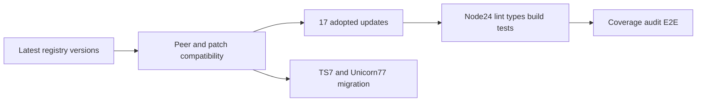

# ADR 064: 2026-10-11依存最新化と型環境の検証

- Status: Accepted
- Date: 2026-10-11
- Supersedes: ADR 061のNode型保留（今回の検証範囲）

## 決定

17種類の使用中パッケージを最新互換版へ更新する。Next 16.4.0でもfast-glob 3.3.1依存が残るため、tinyglobbyによる探索パッチとreadPackage hookを16.4.0へ移植する。既存の代替ディレクトリ・absolute/relative rootDir回帰テストで移植を検証する。

Node型26.6.5を採用するがNode 24実行環境・ES2022対象を維持し、新しいNode APIは導入しない。厳格型チェック・宣言ビルド・Node 24テスト・CIの成功を受入条件とする。型に存在する新APIがNode 24で利用できるとは限らないため、今後のAPI追加時にも実行環境の対応を確認する。

TypeScript 7は最新typescript-eslintのpeer範囲 `>=4.8.4 <6.1.0` とTypeDocの6.0.xまでの範囲外。TypeScript 6.0.3を維持する。Unicorn 77はrecommended設定へ切替えて検証したが、公開boolean名、クラスメンバー順、ネストloopの構造を変更する新規則を検出。既存APIを維持する依存更新とは別の設計移行とし、試行差分は戻す。Unicorn 64を維持し、新しい規則抑制は追加しない。

## 検証経路

## 根拠

[TypeScript 7公式説明](https://devblogs.microsoft.com/typescript/announcing-typescript-7-0/)、[Unicorn設定](https://github.com/sindresorhus/eslint-plugin-unicorn#preset-configs)、最新npm peerメタデータ。警告・エラーの無視、peerチェックの無効化、新たな固定は行わない。
