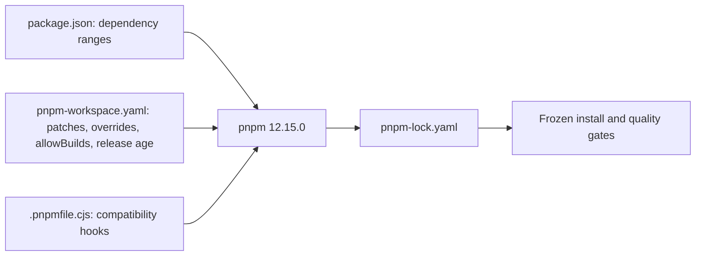

# ADR 065: pnpm 12と開発ツールの保守更新

- 日付: 2026-10-24
- 状態: 検証中

## 背景

2026-10-24の監査でNext・Storybookを含む開発依存の脆弱性を確認した。既存の宣言修正パッチを維持しながら依存関係とツールを更新する必要がある。

## 決定

pnpm 12.15.0を検証し、設定をpackage.jsonからpnpm-workspace.yamlへ移す。onlyBuiltDependenciesは同じ許可対象のallowBuildsへ変換する。strictPeerDependenciesを維持し、minimumReleaseAgeを1440分に明示する。公開直後の版への例外は追加しない。TypeScript 7はtypescript-eslint 8.72.0とTypeDoc 0.28.20のpeer範囲外のため採用しない。

tsup 9では上流でbaseUrl修正が解消したため専用パッチを撤去する。Storybook本体のFireObjectインポートとNuxt DevToolsのsimple-git依存も上流で解消した。各フレームワークの宣言修正とNextのtinyglobby修正は新版へ移植する。依存元が脆弱版を解決する場合のみ、脆弱範囲に限定した互換版の安全下限を指定する。

## 検証と影響

公開APIとエンジン設計は変更しない。frozen install、lint、typecheck、build、test、文書同期、TypeDocと依存監査で確認する。メジャー更新の未検証部分を完了扱いにしない。

