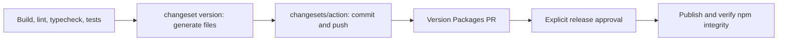

# ADR 066: Release Actionにバージョン変更のコミットを集約する

- 日付: 2026-10-25
- 状態: 提案

## 背景

main `db25265`のRelease実行で、Changesetsはバージョン更新ファイルを生成したが、内部のGitコミットに失敗した。処理は成功扱いで続き、Release ActionがPR #280を更新したため、ワークフローの成功だけでは内部エラーを検知できなかった。

`.changeset/config.json`の`commit: true`は`changeset add`と`changeset version`にGitコミットも行わせる。一方、使用中の`changesets/action@v2`はバージョン生成後のコミットとpushを自分で担当するため、コミット責務が重複している。

## 決定

`commit`を`false`にし、Changesets CLIはファイル生成だけを担当する。CIではRelease Actionが生成結果をコミットして公開候補PRへ反映する。ローカルでも生成結果を確認し、プロジェクトの品質ゲートを通して明示的にコミットする。フックの無効化やエラーの握り潰しは追加しない。バージョン計算・公開対象・公開承認の境界は変更しない。

## 検証

隔離したチェックアウトでfrozen installとバージョン生成に成功した。GitのHEADは変わらず、バージョンが上がる公開45パッケージはPR #280の候補と全件一致した。CLIの内部コミットエラーは発生しなかった。実際のCIコミットは、この変更の統合後にRelease Actionで再確認する。

## 根拠

- [Changesets commit設定](https://github.com/changesets/changesets/blob/main/docs/config-file-options.md#commit-boolean-or-module-path-as-a-string-or-a-tuple-like-modulepath-string-options-any)
- [Release Actionのバージョン生成とpush](https://github.com/changesets/action/blob/main/src/run.ts)
- [Release Actionのコミット処理](https://github.com/changesets/action/blob/main/src/github.ts)
