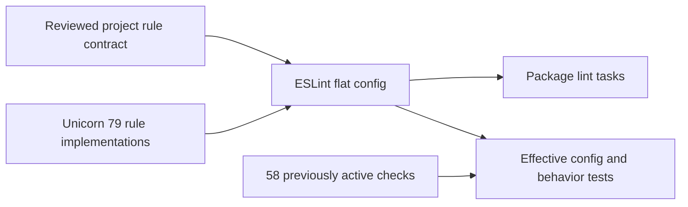

# ADR 067: Explicit Unicorn rule policy

- Date: 2026-10-26
- Status: Validated; integration pending

## Unicorn 79への設定移行 (2026-10-26)

main `d75a296`でPR #288の統合後検証を完了した。Releaseは追加公開なしで成功し、公開済み45版と保留changeset 0件を確認した。CIの失敗は承認済みGHSA-vjh5-4x84-xrqpの誤検出のみで、監査全体の成功とは扱わない。

Unicorn 79の導入では、削除された`flat/recommended`参照と暗黙の推奨ルール継承をやめ、`eslint-unicorn-policy.mjs`にプロジェクトのルール契約を明示する。従来の有効58ルールをすべてerrorで維持し、Promise・文字列置換・比較・bit演算の正確性に関する6ルールを追加する。推奨プリセットのスタイル変更を公開APIの改名理由にせず、追加ルールは個別に審査する。新しいoff・ignore・監査除外は追加しない。各パッケージの実効設定と不正/正当なコードの対比を回帰試験で検証する。公開パッケージの版・API・ES2022対応範囲は変更しない。本移行はfrozen install、lint 98/98、typecheck 99/99、build 56/56、Vitest 149ファイル・1,710件、tooling 15件、TypeDoc、文書同期、全依存/本番依存監査0件を確認した。CodeRabbitの2回のレビュー指摘は修正またはfrozen installの根拠で解決した。リモートCI・統合後検証・公開は未完了。changesetの公開候補は51件のpatch更新で、最終一覧は公開PRで再照合する。

新版の検査で、翻訳値の`$&`・`$$`・前後文脈トークンが置換構文として解釈される不具合を検出した。置換callbackで値をそのまま挿入し、6つの値を反復プレースホルダーで検証する。core・Checkers・Gomokuの内部ガードは副作用のない条件の順序だけを整理する。変更した公開パッケージにはpatch changesetを付け、公開は別途対象と承認を確認する。

## 検証条件

Node 24.22.1 / pnpm 12.15.0のfrozen install、lint、typecheck、build、test、文書同期、TypeDoc、全依存/本番依存監査を実施する。既存58ルールが各設定でerrorであることを確認する。新しいスタイル規約の採用は、公開互換性を評価する別変更で行う。
