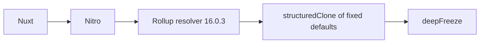

# ADR 068: Remove deepmerge from Rollup resolver

- Date: 2026-10-28
- Status: Validation in progress

## 2026-10-28 保守監査と残件

最新main `ce432366`にはPR #288・#289・#290が統合済み。Unicorn 79移行と51パッケージの公開は完了扱いとし、過去の「統合待ち」「公開待ち」は履歴として読む。現在の未処理はWorkers型更新PR #291、OSV監査、M1b（SRI・キャッシュ完全性）とM1c（応答契約）。TypeScript 7、上流対応後のパッチ撤去、F1–F5の外部前提・将来機能は別に残る。

OSV監査はNuxt 4.6.2のGHSA-vjh5-4x84-xrqpに加え、deepmerge 4.3.1のGHSA-gcqx-w48m-w2h4を検出した。Nuxtの上流PR #10504は未統合。deepmergeはNuxt→Nitro→Rollup resolverの経路にあり、resolver 16.0.3の唯一の使用箇所（固定defaultsの複製）を`structuredClone`へ置換し、readPackage hookで依存を除く。CJS/ESMと不変の既定値を回帰検証する。Workers型の許容下限は5.20261025.1、解決版は保護期間経過済みの5.20261027.1。公開API・公開パッケージの変更はない。監査除外は追加しない。詳細は[ADR 068](adr/068-remove-deepmerge-from-resolver.md)。

References: [advisory](https://github.com/advisories/GHSA-gcqx-w48m-w2h4), [upstream report](https://github.com/TehShrike/deepmerge/issues/273).
