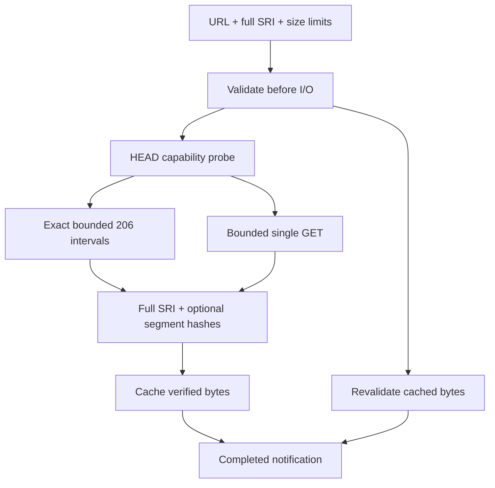

# ADR 069: Verified resource and response contracts

- Date: 2026-10-28
- Status: Locally validated; remote integration pending

## 2026-10-28 SRI・応答契約の修正（検証中）

M1b/M1cを修正中。`ChunkedDownloader.download(url, { sri })`は全体SRIを型・実行時とも必須にし、省略を`SECURITY_ERROR`で拒否する。`EngineLoader`と直接ダウンローダーは保存データを再検証し、キャッシュ識別子はURL・SRI全体からSHA-256で生成し、固定長にする。旧キャッシュは再利用しない。複数SRIは既存SecurityAdvisorの最強アルゴリズム選択に従う。セグメントSRIは全体検証に追加し、segmentSizeと取得幅・hash数を一致させる。

応答は安全な整数のContent-Length、完全一致する206 Content-Rangeとチャンク長を要求する。Range要求への200は拒否する。HEADの通信失敗/非成功は単一GETへfallbackできるが、セキュリティ拒否・中断・不正な長さはfallbackしない。圧縮単一応答は展開後の長さを圧縮時Content-Lengthと比較しない。`maxBytes`は既定512 MiBで、呼出側が明示的に調整でき、streamを上限超過時に中断する。ダウンロード完了通知はSRI・サイズ・中断確認の後だけに行う。

直接APIのSRI省略互換性が変わるためcoreのminor changesetを追加する。移行は`{ sri }`を明示し、大規模資源では必要な`maxBytes`を指定する。EngineLoaderは宣言済みconfig.sizeを上限に用いる。`cacheKey()`の返値はPromiseとなり、awaitが必要。公開は別途対象版と承認を確認する。

