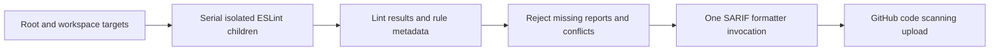

# ADR 070: 依存ファミリーとバージョン別パッチの協調更新

- 日付: 2026-11-07
- 状態: 採用（検証・統合状態はPRで記録）

## 背景

Dependabotの広域minor/patchグループだけでは、候補ごとの解決時にVitest/coverageやStorybookのpeerが揃わず失敗する。またNuxt・Next・Tailwind・Storybook更新は旧版専用パッチを未使用にし、ERR_PNPM_UNUSED_PATCHで停止する。この拒否はパッチの目的を失わないための有効な検査である。

## 決定

依存ファミリーを同時に解決し、全patchedDependenciesとreadPackage hookをレビューする。上流に同等修正がある場合だけパッチを撤去し、まだ必要な変更は新しい配布物へ移植する。strictPeerDependencies、未使用パッチ拒否、24時間のminimumReleaseAgeを緩めない。TypeScript 7は関連ツールが対応するまで別の移行として保持する。

Nitro 2.13.6はarchiver 8のZipArchive APIを使用し、Parcel watcher 2.6.0はpicomatchを使用するため、その旧版パッチとwatcher専用hookを撤去する。Storybook 10.6.6の型制約とNext 16.4.5のtinyglobby移行は引き続きパッチする。glob/minimatchのセキュリティ更新は既存利用経路の回帰検証を必要とする。

回帰試験ではNitroの出力ZIP自身の混入を検出したため、2.13.6向けに出力ファイルを除外する独立パッチを追加する。Tailwindの旧watcher固定は2.6.0以降へ上書きする。minimatch 11で削除されたmakeReを使うimport-xルールは、パターン照合APIへ移植し許可・禁止双方を検証する。 TypeDocのディレクトリ探索も、削除されたmatchOneから公開match APIのpartial指定へ移行する。

コミット前処理では整形後に全lintを実行し、整形が導入する規則違反（toolingの.mjsも含む）をtypecheck/build/testの前に拒否する。

同日の協調監査で、import-xのドットファイル判定の回帰を実fixtureで再現した。元の経路と末尾slash付き経路、それぞれの既定/dot判定を比較し、禁止はOR、許可はANDで束ねる。否定パターン・末尾/**のゼロ階層境界も回帰試験に含める。独立比較33,660組では従来の禁止縮小・許可拡大0件だが、全パターンの数学的な完全互換とは主張しない。旧makeReとの完全互換ではなく、曖昧なドット経路を安全側へ限定する。正規/隠しファイル・明示ドット・否定globの回帰を追加する。

SARIF formatter 3.1.0をrootとlockfileに固定し、CIの動的pnpm addを撤去する。formatterは実行側ESLintを参照するため、バージョン限定hookで古いESLint8依存を検証済みESLint10のpeerへ訂正し、実CLIのSARIF形式・実行版・違反記録を検証する。Nitro2.13.6自身と同じ不要Archiver overrideも撤去する。

全リポジトリを単一プロセスで型解析するSARIFジョブは4GB上限で停止したため、解析を独立プロセスへ分割する。全対象と警告ゼロ条件を維持し、LintResultとrule metadataを集約してformatterを一度だけ実行する。子プロセスの失敗・metadata衝突は拒否し、GitHubの20 runs制限に収まる単一SARIF runを出力する。

npm公式の公開日時を再照合し、24時間経過済みの同一major更新37種類を選定した。Storybook10.6.6とVue3.5.45、Next16.4.5、ESLint10.14等を採用する。TypeScript7のpeer非互換、jsdom31のmajor移行、公開24時間未満の最新版は別に残す。過去の10.6.6待機判断はその時点の時刻に基づくもので、永久保留ではない。

## 検証と制限

frozen install、lint、typecheck、build、test、tooling契約、E2Eと監査を確認する。上流配信元にあるOSVの範囲問題は依存更新とは別の解決経路であり、除外しない。古いCI結果は現在の監査結果の代用にならない。
