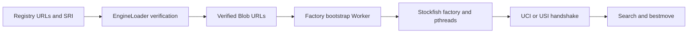

# ADR 071: Fairy-Stockfish browser factoryの起動

- 日付: 2026-11-07
- 状態: 提案・検証状況はPRに記録

## 2026-11-07 Fairy-Stockfish browser起動修正（未統合）

配布stockfish.jsはWorker入口ではなくEmscripten factoryであり、そのままWorker化してもuciok/usiokを返さない。registryのworkerFactoryメタデータで既定資源だけをbootstrapへ接続し、検証済みmain/wasm/pthreadのBlob URLから初期化する。URL・SRIはregistryを正本とし、consumerに複製しない。共有メモリとcross-origin isolationを必須とし、初期化前の命令は上限付きで待機させる。型付きUCI/USI通信、起動失敗、dispose時のWorker/Blob解放を検証する。独自のstandalone Worker上書きとNode native経路は維持する。

PR #301の依存更新head1212b303を土台とする独立stack差分であり、PR #301だけの「追加公開不要」とは別件。core・UCI・USI・Fairy両adapter・registryのruntime修正をChangesetで記録し、公開範囲は依存伝播を含めて別途確認する。公開・merge・releaseは未承認で実施しない。

## 検証と公開境界

scripts/fairy-browser-smokeとCIに実factoryのbrowser試験を保持する。SRI付き既定資源、UCI/USI handshake、合法初手、fallback不使用、dispose完了を検証する。PR #301を土台にSDK差分だけレビューするstack PRでも既存CIを受けられるよう、通常のpull_request検証対象を拡張する。Release workflowは変更しない。Changesets計画は直接6patch・依存伝播後47patchであり、公開許可ではない。adapter終了を待ってから検証済み資源を解放し、Worker runtime error時はpending searchを拒否して無期限busyを防ぐ。

## ライフサイクルの中断

終了時はlifecycle signalをabortし、進行中loadの確定を待ってからadapter停止と検証済み資源の解放を行う。loader生成後・資源ロード後にも中断を確認し、遅れて完了するcustom loaderからキャンセル後にWorkerが作られることを防ぐ。従来fetch30秒・chunked300秒の期限はlifecycle signalと合成して維持する。並行disposeは同じ完了を待つ。中断を無視して永遠に確定しない任意custom adapterまでPromise契約だけで強制停止できるとは扱わず、解放成功として報告しない。Worker障害は進行中探索を拒否し、以後の通信も拒否する。失敗操作でerror状態へ移行した後の明示loadで復帰できるが、自動再起動は行わない。
