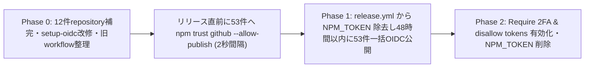

# ADR 072: npm v12インストール時セキュリティ適合とTrusted Publishing (OIDC) 移行

- 日付: 2026-11-22
- 状態: 採用（Phase 0 完了・Phase 1 切替待機）

## 背景

2026-07-08 に npm v12 の一般提供開始（GA）とともに「インストール時セキュリティのデフォルト厳格化」および「2FA バイパス有効 Granular Access Token（GAT）の段階的廃止」が発表された（[GitHub Changelog 2026-07-08](https://github.blog/changelog/2026-07-08-npm-install-time-security-and-gat-bypass2fa-deprecation/) / [npm v12 破壊的変更予告](https://github.blog/changelog/2026-06-09-upcoming-breaking-changes-for-npm-v12/)）。

### 公式仕様およびタイムライン

1. **npm v12 インストール時セキュリティの既定無効化**:
   - `allowScripts`: 依存パッケージの `preinstall` / `install` / `postinstall`・暗黙 `node-gyp rebuild`・git/file/link 依存の `prepare` が既定で実行されない（`npm approve-scripts` による明示許可制）。
   - `--allow-git`: 直接・推移的な Git 依存解決が既定で `none`（`npm >= 11.10.0`）。
   - `--allow-remote`: リモート tarball URL 等からの依存解決が既定で `none`（`npm >= 11.15.0`）。
2. **2FA バイパス GAT の段階的廃止**:
   - **第1段階（2026年8月初旬〜実施済み）**: アカウント設定・トークン発行/削除・メンテナー/Trusted Publishing 設定変更・Org/Team 管理における 2FA バイパスを禁止し、対話的 2FA を必須化。
   - **第2段階（2027年1月ごろ予定）**: 2FA バイパス GAT による直接 `npm publish` を完全廃止。残存権限はプライベートパッケージの読み取りと Staged Publishing（`npm stage publish` → 人間の 2FA 承認で本番公開）のみに縮小。
3. **後続の Trusted Publishing / Staged Publishing 仕様更新（2026-09〜10）**:
   - **2026-09-03**: 1 パッケージ最大 10 件の複数 Trusted Publisher 登録が GA。2026-09-03 以降に新規作成する Trusted Publisher は `npm stage publish` が自動許可され、直接 `npm publish` 許可は選択制となった（[Trusted Publishers Docs](https://docs.npmjs.com/trusted-publishers)）。
   - **2026-09-18**: Stage-only GAT（`Read and write (stage only)`）導入。
   - **2026-10-02**: **未検証 Trusted Publishing 設定は作成から 48 時間（2 日）以内に初回公開を完了しないと自動失効する**仕様へ移行（初回成功後はリポジトリの不変識別子へ紐づき恒久化）。また `issue_comment` / `pull_request_target` 起点の OIDC トークンは拒否され、`push` / `release` / `workflow_dispatch` が推奨される。
   - **実行 CLI 要件**: OIDC 公開自体は `npm >= 11.5.1` & `Node >= 22.14.0`、Staged Publishing および `npm trust` CLI は `npm >= 11.15.0`、dist-tag 操作を伴う OIDC 公開は `npm >= 11.21.0`（または `12.2.0`）が必要（[npm-trust Docs](https://docs.npmjs.com/cli/v12/commands/npm-trust)）。

### リポジトリの実態監査（2026-11-22、`main` `8ce924b6`、ローカル `Node v24.13.0` / `npm 11.21.3` / `pnpm 12.15.0`）

1. **npm v12 利用者互換性**: 公開 53 パッケージすべてで `preinstall` / `install` / `postinstall` / `prepare` **0 件**、`binding.gyp` **0 件**、Git / リモート URL 依存 **0 件**であり、利用者が npm v12 環境でインストールしてもブロックされない。リポジトリ本体も `pnpm@12.15.0` の `allowBuilds`（8 件明示許可）・`minimumReleaseAge: 1440`・`strictPeerDependencies: true` で同等防御を実装済み。
2. **公開ワークフロー依存**: `.github/workflows/release.yml` は `permissions: id-token: write` を宣言済みだが、実際には `NODE_AUTH_TOKEN: ${{ secrets.NPM_TOKEN }}`（現行トークン有効期限 `2026-12-16`）で直接公開している。
3. **12 パッケージの `repository` 欠落**: GitHub Actions OIDC 公開・自動 provenance 生成には `package.json` の `repository.url` が GitHub リポジトリと一致している必要があるが、53 パッケージ中 12 パッケージ（`adapter-janggi`, `adapter-xiangqi`, `domain-gomoku`, `domain-janggi`, `domain-xiangqi`, `i18n-chess`, `i18n-common`, `i18n-core`, `i18n-dashboard`, `i18n-engines`, `i18n-shogi`, `registry`）で `repository` フィールドが未設定。
4. **`scripts/setup-trusted-publishers.mjs` の仕様乖離**: npm バージョン検査が `11.10.0`（現行要件 `11.15.0+`）、`npm trust github` に必須となった `--allow-publish` / `--allow-stage-publish` フラグが未指定、公式推奨のバルク呼び出し間 2 秒スリープ（53 件 ≒ 106 秒、`5 分間 2FA スキップ` 枠内に収めるため必須）が未実装、48 時間失効ルールへの案内・対象絞込がない。
5. **Changesets CLI と 48 時間失効ルール**: `@changesets/cli@3.0.3` は内部的に `pnpm publish --json --access public --tag latest --no-git-checks` を実行するため、`npm stage publish`（`pnpm stage publish`）へはネイティブ対応していない。また、未検証設定が 48 時間で失効するため、未更新パッケージだけ後から設定放置すると再設定が必要になる。
6. **レガシー GAT ワークフローの残存**: `.github/workflows/initial-publish.yml`（全パッケージ公開後に削除予定と記載済み）および `scripts/initial-publish.mjs` / `scripts/sequential-publish.mjs` が 2FA バイパス GAT 前提で残存している。

## 検討した選択肢と決定

| 選択肢                                                                                                                    | 仕組み                                                                                                                                                                                           | 長所                                                                                                                                               | 短所 / 採否                                                                                                                                                                                                     |
| :------------------------------------------------------------------------------------------------------------------------ | :----------------------------------------------------------------------------------------------------------------------------------------------------------------------------------------------- | :------------------------------------------------------------------------------------------------------------------------------------------------- | :-------------------------------------------------------------------------------------------------------------------------------------------------------------------------------------------------------------- |
| **方式 A（推奨・採用案）: OIDC Trusted Publishing（直接 `npm publish` 許可）+ Changesets PR 人間承認 + トークン公開禁止** | GitHub Actions OIDC で `changesets/action@v2` 経由で直接公開し、npm パッケージ設定は「Require 2FA and disallow tokens」へ移行。公開可否は `Version Packages` PR の人間レビュー＋マージで制御する | 長期 `NPM_TOKEN` 完全撤廃・2027年1月以降も継続動作・自動 Provenance 付与・`@changesets/cli@3.0.3` の `pnpm publish` とそのまま整合・保守コスト最小 | 切替時（初回検証リリース）に全 53 パッケージを 48 時間以内に 1 度公開して設定を恒久化する必要がある → **採用**                                                                                                  |
| **方式 B: OIDC Stage-Only + カスタム `pnpm stage publish` + npmjs.com 2FA バッチ承認**                                    | `npm trust github --allow-stage-publish` のみを付与し、CI では `stage publish` だけ行い、npmjs.com の `Staged Packages` で人間が 2FA 承認（1 バッチ最大 100 件）する                             | リポジトリ権限侵害時も本番レジストリ即時反映を防げる                                                                                               | `changesets/action@v2` との連携（git tag 作成・GitHub Release 生成タイミング・Changesets publish plan 再構築）の独自実装が重く、2FA 承認漏れリスク増大 → 将来的な高セキュリティ要件時の拡張案（現時点は不採用） |
| **方式 C: 2FA バイパス GAT の Stage-Only（`Read and write (stage only)`）移行**                                           | 90 日トークンの権限を stage-only に落とし `NPM_TOKEN` 運用を続ける                                                                                                                               | OIDC 不要                                                                                                                                          | 90 日ごとのトークンローテーション継続・静的秘密鍵残存・プロビナンス自動生成メリットなし → **不採用**                                                                                                            |

### 決定事項

1. **方式 A（OIDC Trusted Publishing + Changesets 運用 + トークン公開禁止）を正式採用方針として提案**する。
2. **段階的移行（Phase 0 → Phase 1 → Phase 2）**:
   - **Phase 0（事前コード・設定整備 PR）**:
     - 欠落している 12 パッケージの `package.json` へ `repository` メタデータを補完（`scripts/polish-metadata.mjs` または対象限定更新で既存フィールド破壊を防止）。
     - `scripts/setup-trusted-publishers.mjs` を `npm >= 11.15.0` 要件・`--allow-publish` 明示・2 秒レート制御・設定済み `allowedActions` 検査に対応させる。
     - 役割を終えた `.github/workflows/initial-publish.yml` の廃止整理と、`scripts/initial-publish.mjs` / `scripts/sequential-publish.mjs` の位置づけ（新規パッケージ追加時のみ使う手動ツール等）の明確化。
   - **Phase 1（OIDC 切替・全 53 パッケージ 48 時間以内検証リリース — 期限: 現 `NPM_TOKEN` 満了の 2026-12-16 より前）**:
     - 全 53 パッケージ分の patch changeset を用意し、リリース直前に `pnpm run npm:setup-oidc`（Web 2FA で「5 分間 2FA スキップ」を有効化し約 2 分で 53 件設定）を実行。
     - `.github/workflows/release.yml` から `NODE_AUTH_TOKEN: ${{ secrets.NPM_TOKEN }}`（および OIDC トークン交換を阻害する恐れのある設定）を除去し、純粋 OIDC で全 53 パッケージを公開・48 時間以内に設定を検証済み（恒久化）にする。
   - **Phase 2（長期秘密鍵撤去・トークン公開完全禁止 — 期限: Phase 1 完了直後〜2027年1月前）**:
     - 全 53 パッケージで npm `Publishing access` を `"Require two-factor authentication and disallow tokens"` へ変更。
     - GitHub Actions Secret `NPM_TOKEN` を削除し、npmjs.com 上の 2FA バイパス GAT を Revoke する。

## 検証と制限

- **完了済み（Phase 0、2026-11-22）**: 欠落していた公開 12 パッケージへの `repository` メタデータ補完（53/53 件一致）、`scripts/setup-trusted-publishers.mjs` の npm 11.15.0+・`--mode`（`--allow-publish` 等）・2 秒スリープ・48 時間警告対応、`.github/workflows/initial-publish.yml` 廃止整理、および `scripts/validation.test.mjs` への 3 種類の恒久回帰テスト追加を完了。
- **事前検証条件**: `pnpm install --frozen-lockfile`・`pnpm lint`・`pnpm typecheck`・`pnpm build`・`pnpm test`・`pnpm run doc-sync` をすべて通過すること。
- **本番切替検証（Phase 1〜2）**: OIDC 公開ログ上の Provenance 署名出力、全 53 パッケージの npm 上の `dist.integrity` と Trusted Publisher 検証済み状態、`NPM_TOKEN` 削除後の次期テストリリース成功を確認する。
- **制約**: GitHub Secrets の削除や `npm trust github`・npmjs.com の `Publishing access` 変更はユーザーによる対話的 2FA 認証が必要なため、Phase 1 のリリース直前にユーザー承認・対話操作と連動して実施する。
