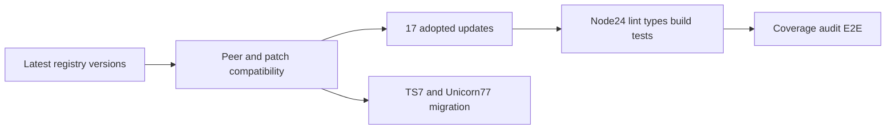

# ADR 064: Dependency refresh and type-environment validation

- Status: Accepted
- Date: 2026-10-11
- Supersedes: ADR 061 Node-type deferral within this validation scope

## Decision

Adopt current compatible versions of 17 used packages. Next 16.4.0 still depends on fast-glob 3.3.1, so port the tinyglobby directory-discovery patch and readPackage hook. Verify alternative directory patterns and absolute/relative rootDir using existing regressions.

Adopt Node types 26.6.5 while retaining Node 24 and ES2022; introduce no new Node APIs. Require strict typechecking, declaration builds, Node 24 tests and CI. New APIs present in types may be unavailable on Node 24, so future API additions must verify runtime support.

Latest typescript-eslint peers require `>=4.8.4 <6.1.0`; TypeDoc supports through 6.0.x. Keep TypeScript 6.0.3. Tried Unicorn 77 recommended configuration; new rules require changes to public boolean names, class member ordering and nested-loop structure. Keep that design migration separate from API-preserving dependency maintenance and revert the trial. Retain Unicorn 64 without adding rule suppressions.

## Validation path

## Evidence

[Official TypeScript 7 announcement](https://devblogs.microsoft.com/typescript/announcing-typescript-7-0/), [Unicorn configuration](https://github.com/sindresorhus/eslint-plugin-unicorn#preset-configs), current npm peer metadata. No warning suppression, peer-check bypass or new pin is introduced.
