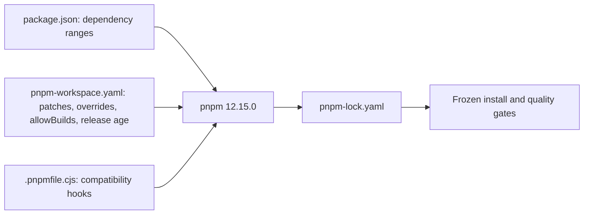

# ADR 065: pnpm 12 and development toolchain maintenance

- Date: 2026-10-24
- Status: Under validation

## Context

The 2026-10-24 audit found development dependency vulnerabilities including Next and Storybook. Dependencies and tools need updating while retaining necessary declaration fixes.

## Decision

Evaluate pnpm 12.15.0 and move configuration from package.json to pnpm-workspace.yaml. Replace onlyBuiltDependencies with allowBuilds for the same approved packages. Retain strictPeerDependencies and explicitly set minimumReleaseAge to 1440 minutes. Do not add exceptions for newly published versions. TypeScript 7 is outside the peer ranges of typescript-eslint 8.72.0 and TypeDoc 0.28.20 and is not adopted.

tsup 9 fixes the baseUrl defect upstream, so remove its patch. The Storybook core FireObject import and Nuxt DevTools simple-git dependency are also resolved upstream. Port framework declaration fixes and the Next tinyglobby fix to the new releases. Only introduce compatible security lower bounds for vulnerable ranges when upstream dependencies still resolve affected versions.

## Validation and consequences

Public APIs and engine architecture remain unchanged. Verify frozen installation, lint, typecheck, build, tests, document synchronization, TypeDoc and dependency auditing. Do not describe unverified major migrations as complete.

