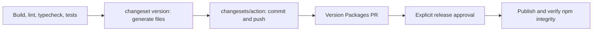

# ADR 066: Let the Release Action own version commits

- Date: 2026-10-25
- Status: Proposed

## Context

The Release run for main `db25265` generated version files, but Changesets failed its internal Git commit. Execution continued successfully and the Release Action updated PR #280, so workflow success alone did not establish that the internal operation succeeded.

`commit: true` in `.changeset/config.json` makes `changeset add` and `changeset version` also create Git commits. The configured `changesets/action@v2` already owns the commit and push after version generation, duplicating that responsibility.

## Decision

Set `commit` to `false`; the Changesets CLI only generates files. In CI, the Release Action commits the result and updates the release proposal PR. Locally, review the generated files and commit explicitly through the project quality gates. Do not disable hooks or suppress errors. Version calculations, release targets and publication approval boundaries remain unchanged.

## Validation

Frozen installation and version generation passed in an isolated checkout. Git HEAD remained unchanged; all 45 bumped public package versions match release PR #280. No internal CLI commit error occurred. Recheck the actual CI commit through the Release Action after this change merges.

## References

- [Changesets commit option](https://github.com/changesets/changesets/blob/main/docs/config-file-options.md#commit-boolean-or-module-path-as-a-string-or-a-tuple-like-modulepath-string-options-any)
- [Release Action version generation and push](https://github.com/changesets/action/blob/main/src/run.ts)
- [Release Action commit handling](https://github.com/changesets/action/blob/main/src/github.ts)
