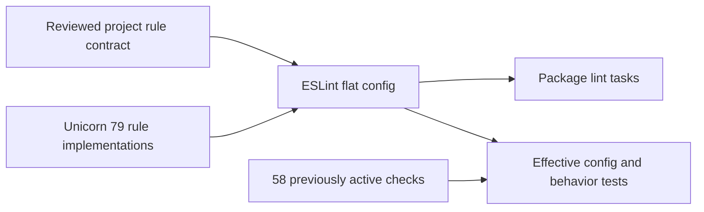

# ADR 067: Explicit Unicorn rule policy

- Date: 2026-10-26
- Status: Validated; integration pending

## Unicorn 79 configuration migration (2026-10-26)

Post-merge verification of PR #288 completed on main `d75a296`. Release succeeded without additional publication; all 45 published versions remain unchanged and no changesets are pending. CI failed only for the approved GHSA-vjh5-4x84-xrqp false positive; the complete audit is not reported as successful.

The Unicorn 79 migration replaces the removed `flat/recommended` reference and implicit recommendation inheritance with an explicit project rule contract in `eslint-unicorn-policy.mjs`. All 58 previously enabled rules remain errors, with six additional correctness rules for promises, string replacement, comparisons and bitwise operations. Upstream style-preset changes do not dictate public API renames; additional rules are reviewed individually. No new off settings, ignores or audit exclusions are added. Regression tests check effective package configurations and contrasting invalid/valid code. Public package versions, APIs and the ES2022 support contract remain unchanged. Frozen install, lint 98/98, typecheck 99/99, build 56/56, 149 Vitest files / 1,710 tests, 15 tooling tests, TypeDoc and document synchronization passed. Full and production pnpm audits both report zero advisories. Findings from two CodeRabbit passes were corrected or resolved with frozen-install evidence. Remote CI, post-merge verification and publication remain pending. Changeset status proposes 51 public patch updates; the final list must be reconciled in the release PR.

The updated checks exposed translation values such as `$&`, `$$` and context tokens being interpreted as replacement syntax. A replacement callback inserts values literally, with six regression cases using repeated placeholders. Internal guards in core, Checkers and Gomoku only reorder conditions without side effects. Changed public packages receive patch changesets; publication requires separate confirmation of targets and authorization.

## Acceptance criteria

Run frozen install, lint, typecheck, build, test, document synchronization, TypeDoc and full/production dependency audits on Node 24.22.1 / pnpm 12.15.0. Verify all 58 existing rules remain errors in effective package configurations. Adoption of additional style conventions requires a separate change evaluating public compatibility.
