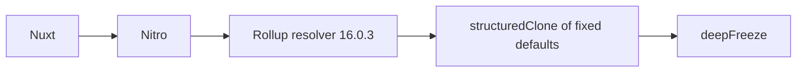

# ADR 068: Remove deepmerge from Rollup resolver

- Date: 2026-10-28
- Status: Locally validated; remote integration pending

## 2026-10-28 maintenance audit and remaining work

Main `ce432366` includes PRs #288, #289 and #290. The Unicorn 79 migration and 51-package release are complete; earlier integration/publication pending statements are historical. Remaining work includes Workers type update PR #291, OSV auditing, M1b (SRI/cache integrity), and M1c (response contracts). TypeScript 7, upstream-dependent patch removal, and F1–F5 external prerequisites/future features remain separate.

OSV now reports GHSA-gcqx-w48m-w2h4 in deepmerge 4.3.1 in addition to the Nuxt 4.6.2 GHSA-vjh5-4x84-xrqp finding. Upstream Nuxt advisory PR #10504 remains open. The Nuxt→Nitro→Rollup resolver path uses deepmerge only to clone fixed defaults. A version-scoped patch replaces this operation with `structuredClone`, and a readPackage hook removes the dependency. Regression checks cover CJS/ESM and frozen defaults. Workers types use a ^5.20261025.1 range and resolve to mature 5.20261027.1. Public packages and APIs are unchanged; no audit exclusions are added.

References: [advisory](https://github.com/advisories/GHSA-gcqx-w48m-w2h4), [upstream report](https://github.com/TehShrike/deepmerge/issues/273).
