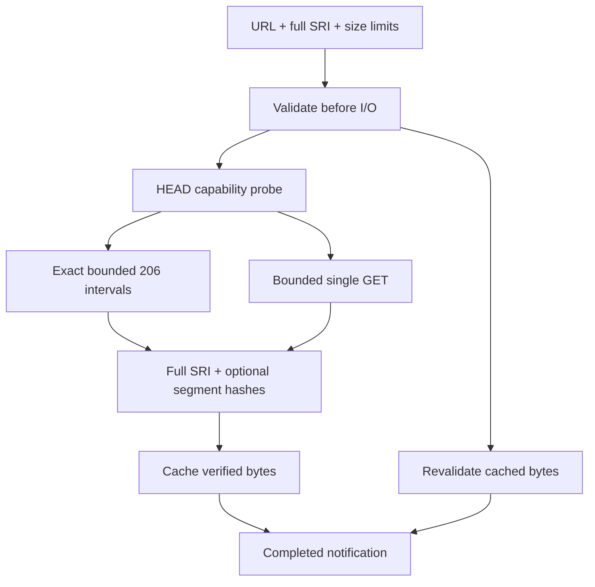

# ADR 069: Verified resource and response contracts

- Date: 2026-10-28
- Status: Locally validated; remote integration pending

## 2026-10-28 SRI and response contract changes (validation in progress)

M1b/M1c are being addressed. `ChunkedDownloader.download(url, { sri })` requires full-resource SRI in its type and at runtime; omission raises `SECURITY_ERROR`. Both EngineLoader and direct downloads revalidate persisted bytes. Cache identities hash complete URLs and SRI values with SHA-256 into fixed-length names, so old cache entries are not reused. Multiple hashes use SecurityAdvisor's strongest-algorithm selection. Segment hashes supplement the full hash and must match segmentSize, request width, and resource size.

Responses require safe integer Content-Length values, exact 206 Content-Range intervals, and exact chunk lengths. A 200 response to a Range request is rejected. HEAD transport failures/non-success may fall back to a single GET; security refusal, abort, and malformed lengths cannot. Compressed single responses are not compared against compressed Content-Length. `maxBytes` defaults to 512 MiB and can be explicitly adjusted; streaming stops on overflow. Completion is emitted only after integrity, size, and abort checks.

A core minor changeset records the direct API compatibility change. Migrate callers to explicit `{ sri }` and supply `maxBytes` when large resources require it. EngineLoader uses declared config.size as its limit. `cacheKey()` now returns a Promise and must be awaited. Publication requires separate version/scope approval.

