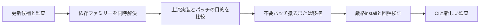

# ADR 070: Coordinate dependency families and version-specific patches

- Date: 2026-11-07
- Status: Accepted (validation and integration recorded in the PR)

## Context

A broad Dependabot minor/patch group does not guarantee that individual candidate resolution aligns Vitest/coverage or Storybook peers. Nuxt, Next, Tailwind and Storybook updates also leave version-specific patches unused, causing ERR_PNPM_UNUSED_PATCH. This rejection protects the purpose of each patch.

## Decision

Resolve related dependency families together and review all patchedDependencies and readPackage hooks. Remove a patch only when equivalent upstream behavior is present; otherwise port it to the new distribution. Retain strictPeerDependencies, unused-patch rejection and the 24-hour minimumReleaseAge. Keep TypeScript 7 as a separate migration until related tooling supports it.

Nitro 2.13.6 uses archiver 8's ZipArchive API, and Parcel watcher 2.6.0 uses picomatch, so remove their old patches and the watcher-specific hook. Continue patching Storybook 10.6.5 type constraints and Next 16.4.5 root discovery with tinyglobby. Security updates to glob/minimatch require regression checks of existing consumers.

A regression test exposed Nitro including its output ZIP in itself, so a separate 2.13.6 patch excludes that file. Override Tailwind’s old watcher pin to 2.6.0 or later. Port the import-x rule from minimatch 11’s removed makeRe API to pattern matching and test both allow and forbid behavior. TypeDoc directory traversal also moves from the removed matchOne method to the public match API with partial matching.

## Validation and limitations

Check frozen install, lint, typecheck, build, test, tooling contracts, E2E and auditing. The upstream OSV range problem requires a separate correction path and must not be suppressed. Historical CI results do not substitute for a fresh audit.
