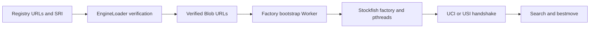

# ADR 071: Fairy-Stockfish browser factory bootstrap

- Date: 2026-11-07
- Status: Proposed; validation tracked in the PR

## 2026-11-07 Fairy-Stockfish browser bootstrap fix (not integrated)

The distributed stockfish.js defines an Emscripten factory rather than a Worker entry and cannot return uciok/usiok when launched directly. Registry workerFactory metadata selects the bootstrap only for default assets. Instantiate it using loader-verified main/WASM/pthread Blob URLs; keep URLs and SRI in the registry rather than copying them into consumers. Require shared memory and cross-origin isolation, bound commands queued during initialization, and verify typed UCI/USI handshakes, search, failures and Worker/Blob cleanup. Preserve custom standalone Worker overrides and native Node binaries.

This is an independent stacked diff based on dependency PR #301 head1212b303. The dependency-only no-publication statement in PR #301 does not apply to this runtime fix. Record core, UCI, USI, both Fairy adapters and registry in a Changeset, and review transitive release scope separately. Publication, merge and release remain unauthorized.

## Validation and release boundary

Keep the real factory browser smoke in scripts/fairy-browser-smoke and CI. It checks SRI-backed defaults, UCI/USI handshakes, legal initial moves, no fallback and disposal. Extend ordinary pull-request validation to stacked PR targets so SDK-only reviews based on PR #301 still receive the existing checks. No Release workflow is changed. Changesets currently plans six direct patches and 47 patches after dependency propagation; this is a plan, not a publication authorization. Await adapter shutdown before revoking verified resources, and reject pending searches on Worker runtime errors instead of leaving them busy indefinitely.

## Lifecycle cancellation

Disposal aborts the lifecycle signal and waits for the in-flight load to settle before stopping the adapter and revoking verified resources. Check cancellation after loader creation and resource loading so a late custom loader cannot create a Worker after cancellation. Keep the existing 30-second fetch and 300-second chunked deadlines by composing timeout and lifecycle signals. Concurrent disposal calls share completion. An arbitrary custom adapter that ignores cancellation and never settles cannot be forcibly stopped by this Promise contract; do not report it as cleaned up. Worker faults reject in-flight searches and prevent later communication, while an explicit subsequent load may recover the adapter after the failed operation marks it as error.
