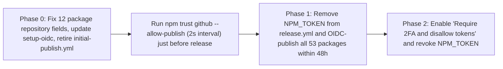

# ADR 072: npm v12 install-time security compliance and Trusted Publishing (OIDC) migration

- Date: 2026-11-22
- Status: Accepted (Phase 0 complete; ready for Phase 1 cutover)

## Context

On 2026-07-08, alongside the general availability of npm v12, GitHub and npm announced stricter install-time security defaults and a phased deprecation of 2FA-bypass Granular Access Tokens (GATs) ([GitHub Changelog 2026-07-08](https://github.blog/changelog/2026-07-08-npm-install-time-security-and-gat-bypass2fa-deprecation/) / [npm v12 breaking changes](https://github.blog/changelog/2026-06-09-upcoming-breaking-changes-for-npm-v12/)).

### Official Specifications and Timeline

1. **npm v12 install-time security defaults**:
   - `allowScripts` defaults to off: dependency `preinstall`/`install`/`postinstall` scripts, implicit `node-gyp rebuild`, and git/file/link `prepare` scripts are blocked unless explicitly approved via `npm approve-scripts`.
   - `--allow-git` defaults to `none` (requires explicit opt-in, npm >= 11.10.0).
   - `--allow-remote` defaults to `none` (requires explicit opt-in for remote tarball URLs, npm >= 11.15.0).
2. **Phased deprecation of 2FA-bypass GATs**:
   - **Phase 1 (effective early August 2026)**: 2FA-bypass GATs can no longer perform account, token, maintainer, organization/team, or trusted publishing management actions; interactive 2FA is mandatory.
   - **Phase 2 (expected around January 2027)**: Direct `npm publish` via 2FA-bypass GATs will be removed entirely. Remaining permissions shrink to reading private packages and staged publishing (`npm stage publish`, pending human 2FA approval).
3. **Subsequent Trusted / Staged Publishing Updates (Sep–Oct 2026)**:
   - **2026-09-03**: Multiple Trusted Publishers (up to 10 per package) became GA. Trusted publisher configurations created on or after 2026-09-03 automatically enable `npm stage publish` while direct `npm publish` permission is optional ([Trusted Publishers Docs](https://docs.npmjs.com/trusted-publishers)).
   - **2026-09-18**: Stage-only GATs (`Read and write (stage only)`) introduced.
   - **2026-10-02**: **Unvalidated trusted publishing configurations expire 48 hours (2 days) after creation** if they have not completed a successful publish (the first publish validates and permanently binds the config). Tokens minted from `issue_comment` and `pull_request_target` events are rejected (`push`, `release`, or `workflow_dispatch` should be used).
   - **CLI Requirements**: OIDC publishing requires `npm >= 11.5.1` and `Node >= 22.14.0`; staged publishing and `npm trust` require `npm >= 11.15.0`; OIDC dist-tag management requires `npm >= 11.21.0` / `12.2.0` ([npm-trust Docs](https://docs.npmjs.com/cli/v12/commands/npm-trust)).

### Repository Audit Findings (2026-11-22, `main` `8ce924b6`, local `Node v24.13.0` / `npm 11.21.3` / `pnpm 12.15.0`)

1. **npm v12 Consumer Compatibility**: Across all 53 public packages under `packages/*`, there are `0` lifecycle scripts (`preinstall`/`install`/`postinstall`/`prepare`), `0` `binding.gyp` files, and `0` Git or remote URL dependencies. Internally, the workspace uses `pnpm@12.15.0` with explicit `allowBuilds` (8 packages), `minimumReleaseAge: 1440`, and `strictPeerDependencies: true`.
2. **Publishing Secret Dependency**: Although `.github/workflows/release.yml` declares `id-token: write`, it currently passes `NODE_AUTH_TOKEN: ${{ secrets.NPM_TOKEN }}` (current 2FA-bypass GAT expires `2026-12-16`) for direct publishing.
3. **Missing `repository` Metadata in 12 Public Packages**: GitHub Actions OIDC publishing and automatic provenance generation require `package.json` `repository.url` to match the GitHub repository, yet 12 of the 53 public packages (`adapter-janggi`, `adapter-xiangqi`, `domain-gomoku`, `domain-janggi`, `domain-xiangqi`, `i18n-chess`, `i18n-common`, `i18n-core`, `i18n-dashboard`, `i18n-engines`, `i18n-shogi`, `registry`) omit `repository`.
4. **Outdated `scripts/setup-trusted-publishers.mjs`**: Still checks `npm >= 11.10.0` (instead of `11.15.0+`), omits mandatory `--allow-publish` / `--allow-stage-publish` flags on `npm trust github`, lacks the recommended 2-second rate-limit delay for bulk setup inside the 5-minute 2FA skip window (~106s for 53 packages), and does not warn about the 48-hour expiry rule.
5. **Changesets CLI & 48-Hour Validation Window**: `@changesets/cli@3.0.3` invokes `pnpm publish --json --access public --tag latest --no-git-checks` and has no native `pnpm stage publish` integration. Furthermore, partial releases leave untouched packages unvalidated past 48 hours, requiring an initial full 53-package coordinated patch release immediately after configuring trust.
6. **Legacy GAT Workflows/Scripts**: `.github/workflows/initial-publish.yml` (documented for deletion after initial publish) and `scripts/initial-publish.mjs` / `scripts/sequential-publish.mjs` remain tailored to 2FA-bypass GAT publishing.

## Decision

| Option                                                                                                             | Mechanism                                                                                                                                                                                       | Pros                                                                                                                                                             | Cons / Verdict                                                                                                                  |
| :----------------------------------------------------------------------------------------------------------------- | :---------------------------------------------------------------------------------------------------------------------------------------------------------------------------------------------- | :--------------------------------------------------------------------------------------------------------------------------------------------------------------- | :------------------------------------------------------------------------------------------------------------------------------ |
| **Option A (Recommended): OIDC Trusted Publishing (`--allow-publish`) + Changesets PR approval + Disallow Tokens** | Publish via GitHub Actions OIDC through `changesets/action@v2`, enforce human review via the `Version Packages` PR merge gate, and switch package settings to "Require 2FA and disallow tokens" | Eliminates long-lived `NPM_TOKEN`, survives January 2027 deprecation, enables automatic provenance, works natively with `@changesets/cli@3.0.3` + `pnpm publish` | Requires publishing all 53 packages within 48 hours of configuring OIDC trust on initial cutover → **Adopt**                    |
| **Option B: OIDC Stage-Only + Custom `pnpm stage publish` + Batch 2FA Approval**                                   | Grant only `--allow-stage-publish`, push tarballs to staging in CI, and batch-approve with 2FA on `npmjs.com` (up to 100 versions/batch)                                                        | Blocks immediate registry publication even if repo workflow access is compromised                                                                                | Breaks Changesets release/tag lifecycle without heavy custom scripting and adds manual post-CI 2FA steps → Deferred alternative |
| **Option C: Stage-Only 2FA-Bypass GAT**                                                                            | Downgrade `NPM_TOKEN` to `Read and write (stage only)`                                                                                                                                          | Minimal workflow change                                                                                                                                          | Retains 90-day static token rotation and lacks automatic OIDC provenance → **Reject**                                           |

### Migration Phases

1. **Phase 0 (Preparation PR)**: Populate `repository` across the 12 missing packages, update `scripts/setup-trusted-publishers.mjs` (`npm >= 11.15.0`, `--allow-publish`, 2s sleep, permission verification), and retire `.github/workflows/initial-publish.yml`.
2. **Phase 1 (OIDC Cutover & 48h Full-Validation Release — before current `NPM_TOKEN` expiry `2026-12-16`)**: Prepare patch changesets for all 53 packages, run `pnpm run npm:setup-oidc` right before merging the release PR (using npm's 5-minute 2FA skip window), remove `NODE_AUTH_TOKEN` overrides from `release.yml`, and publish all 53 packages via OIDC within 48 hours.
3. **Phase 2 (Token Decommission — immediately after Phase 1, before Jan 2027)**: Enable `"Require two-factor authentication and disallow tokens"` across all 53 packages, delete `NPM_TOKEN` from GitHub Secrets, and revoke the GAT on npmjs.com.

## Verification and Limitations

- **Phase 0 Completed (2026-11-22)**: Populated `repository` metadata across all 12 missing public packages (53/53 verified), upgraded `scripts/setup-trusted-publishers.mjs` (`npm >= 11.15.0`, `--mode` with `--allow-publish`, 2s rate delay, 48-hour expiry guidance), removed `.github/workflows/initial-publish.yml`, and added permanent regression tests in `scripts/validation.test.mjs`.
- **Pre-merge checks**: `pnpm install --frozen-lockfile`, `pnpm lint`, `pnpm typecheck`, `pnpm build`, `pnpm test`, and `pnpm run doc-sync` must pass.
- **Cutover verification (Phases 1–2)**: Verify automatic provenance attestations in release logs, `dist.integrity` across all 53 packages on npm, active Trusted Publisher bindings, and subsequent release success after `NPM_TOKEN` removal.
- **Scope note**: `npm trust github`, npmjs.com `Publishing access` lockdown, and `NPM_TOKEN` deletion require interactive 2FA and are queued for Phase 1/2 execution right before the coordinated release.
